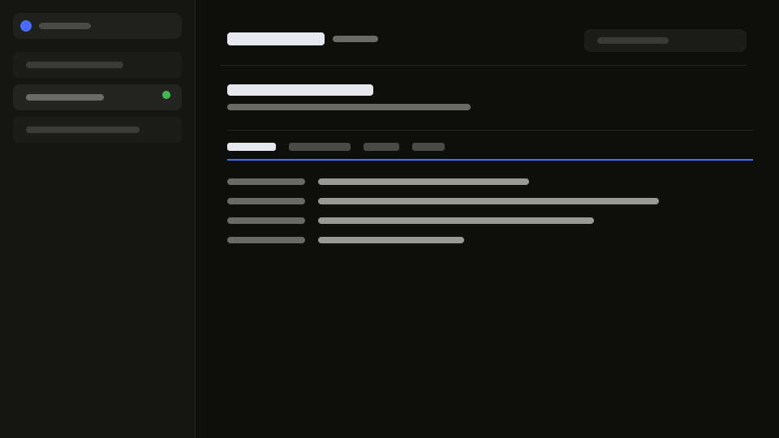

# Skill Forge

<p align="center">
  <a href="https://github.com/moyuer233/dsh-skill-forge"></a>
  <a href="https://github.com/moyuer233/dsh-skill-forge"></a>
  <a href="https://github.com/moyuer233/dsh-skill-forge/blob/main/LICENSE"></a>
  <a href="https://github.com/moyuer233/dsh-skill-forge"></a>
  <a href="https://nodejs.org"></a>
</p>

左侧栏加一个入口，点开是主区面板，用来管这台机器上的 skill：看、查、校验、新建。

施工中。评测闭环还没做，接口和文件结构会变，别基于当前版本写依赖。缺哪些见「还没做」。



## 装

插件还没发版，从本地目录装。在 DSH 里打开「插件」页，点「添加插件」，选 `dsh-skill-forge` 这个目录，然后完全退出 DSH（含托盘）再打开。

装完左侧栏「上下文洞察」下面会多一个「技能工坊」，点开就是面板。

## 面板里有什么

| 区域 | 做什么 |
|---|---|
| 列表 | 当前工作区可见的全部 skill，显示名字和两行描述；搜索框按名字和描述过滤 |
| 概览 | 来源目录、磁盘路径、行数与字节数、description、什么时候用 |
| SKILL.md | 原文，等宽字体，自动换行 |
| 校验 | 跑格式检查，分错误与提醒两档 |
| 文件 | skill 目录下的文件与子目录 |
| 新建 | 填名字和 description，选一个用户级根目录，生成带注释的 SKILL.md 骨架 |

## 校验查什么

错误会判为不合格：

- frontmatter 缺失、没闭合、或含无法解析的行
- `name` 缺失、不是 kebab-case、或与目录名不一致
- 未知的 frontmatter 字段
- `description` 缺失，或超过 1024 字符
- 正文超过 500 行，或少于 100 字符

提醒不判不合格，但会影响触发：

- `description` 短于 30 字符
- `description` 里看不出「什么时候用」
- SKILL.md 里引用的 `references/`、`scripts/` 文件不存在

## 还没做

Claude Code 原版 skill-creator 的核心是「写 → 测 → 评 → 改」的闭环，这一版只有前半段。

| 能力 | 状态 |
|---|---|
| 列出 skill、读 SKILL.md、格式校验、新建骨架 | 有 |
| 生成测试用例（evals） | 无 |
| 带 skill / 不带 skill 对照跑 | 无 |
| 评分与 benchmark 聚合 | 无 |
| viewer 看输出、留反馈 | 无 |
| 按反馈迭代 skill | 无 |
| description 触发率优化 | 无 |
| 打包成 `.skill` | 无 |

底层的评测脚本已经在 `dsh-skill-creator` 里写好并跑通过（`run_eval.mjs`、`aggregate_benchmark.mjs`、`run_loop.mjs`、`generate_review.mjs`、`package_skill.mjs`），但目前只有模型能调，面板上没有入口。

## 支持的平台

| 平台 | 状态 |
|---|---|
| DSH Desktop（Windows，0.2.2-rc.3） | 已实测：侧栏入口、135 个 skill 加载、详情四个 tab、校验出「格式有效」、搜索过滤（135→3）、新建 skill 落盘并被注册表热加载、刷新计数 |
| DSH Web（浏览器） | 部分实测：面板渲染、四个 tab、搜索、新建弹窗、校验请求、错误态与空态，在 jsdom + 真实 React 18 里跑通；浏览器真机没单独跑过 |
| DSH CLI / headless | 不适用，面板是 Client 插件，headless 没有界面 |

## 已知限制

- 面板只读，不能编辑 skill。改了要落盘再让注册表重扫，这一版没做。
- 新建只写 `~/.dsh/skills` 与 `~/.agents/skills`，不写项目目录，不覆盖已存在目录。
- 没有磁盘目录的 skill（插件自带的），校验和文件两页会说明无法进行。
- 校验只查格式，不判断内容写得好不好。

## 自检

三套自检，共 161 条断言。

```bash
# 包结构 + 纯函数
node test/selftest.mjs

# Host 四条路由的接线（假 ctx + 临时目录）
node test/host.mjs
```

Client 那套要 React 与 jsdom，测试依赖不装进插件：

```bash
mkdir -p H:/1/_rtest && cd H:/1/_rtest
npm install react@18.3.1 react-dom@18.3.1 jsdom
```

然后指定依赖目录跑：

```bash
SF_REACT_DIR=H:/1/_rtest/node_modules node test/client.mjs

# 或者一次跑完三套
SF_REACT_DIR=H:/1/_rtest/node_modules node test/run-all.mjs
```

## 反馈

开 issue 时带上 DSH 版本（`dsh --version`）、面板里看到的现象（截图最好）、控制台报错原文（F12 → Console）。

## 协议

MIT。作者 [MoyuStarry](https://space.bilibili.com/514699365)。
